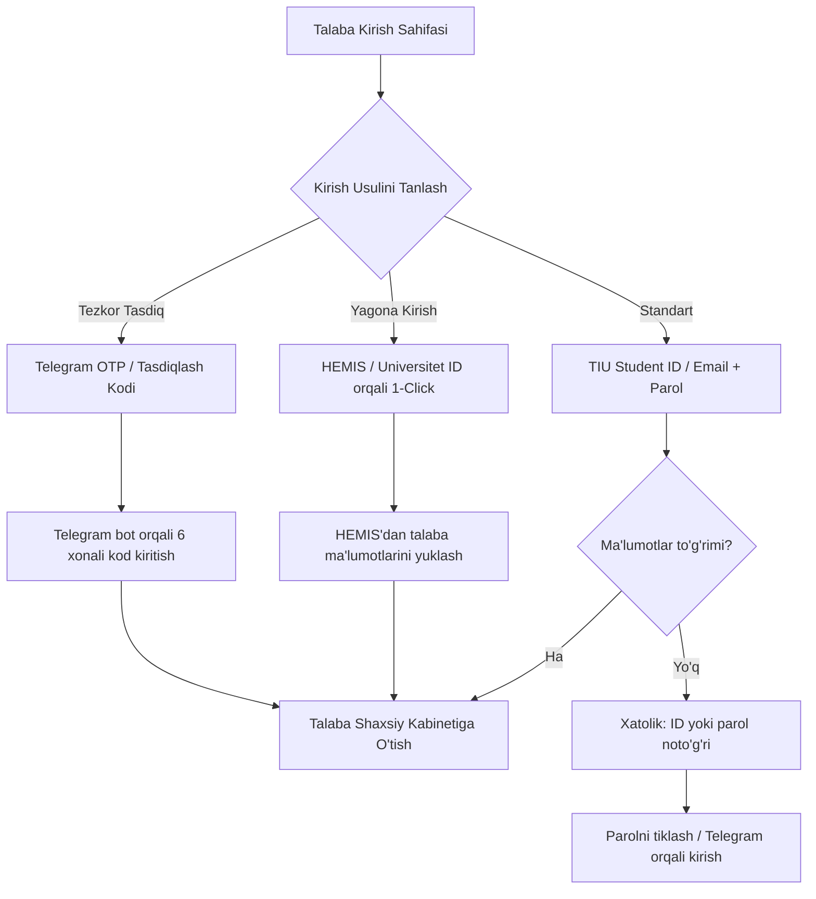
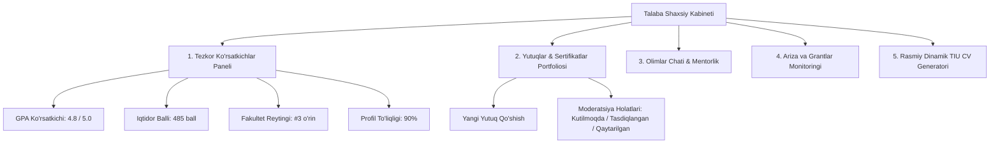

# TIU Talents — Talaba Login Qismi va Shaxsiy Kabineti: Minimalist Dizayn & Tizimli Mantiq (Architecture & UX Flow)

**Loyiha:** TIU Talents  
**Bo'lim:** Talaba Moduli (Student Auth & Personal Cabinet)  
**Dizayn Tili:** Ultra-minimalist, Clean SaaS (Apple / Linear / Notion estetikasida, toza bo'shliqlar, chuqur o'qiluvchanlik)  

---

## 1. Talaba Autentifikatsiya (Login & Onboarding) Mantiqi

Talaba tizimga kirishi maksimal sodda, tezkor va xavfsiz bo'lishi kerak. Universitet ma'muriyati va HEMIS bazasi bilan avtomatik integratsiya hisobga olingan.

### 1.1 Login Ekranining Minimalist Elementlari
1. **Brending:** Chap yoki markazda toza TIU Talents logotipi (3D glass pufakchalar + nozik "TIU Talents" yozuvi).
2. **Kirish Shakli (Clean Card):**
   * **Login Maydoni:** `Talaba ID raqami` (masalan: `TIU2024-0492`) yoki Universitet korporativ emaili (`@tiu.uz`).
   * **Parol Maydoni:** Parolni yashirish/ko'rsatish ko'zcha belgisi bilan.
   * **Yordamchi havolalar:** "Meni eslab qol" (Remember me checkbox) va "Parolni unutdingizmi?".
   * **Asosiy Tugma:** `Tizimga Kirish` (Qora / To'q Ko'k minimalist to'liq tugma).
   * **Muqobil Tezkor Kirish (SSO):**
     * `🏛️ TIU HEMIS orqali kirish` (avtomatik talaba kurs/fakultetini tortadi).
     * `✈️ Telegram orqali tezkor tasdiqlash` (bir marta bosishda Telegram bot orqali kirish).

---

## 2. Talaba Shaxsiy Kabinetining To'liq Mantiqiy Tuzilmasi (Dashboard Logic)

Talaba kabineti chalg'ituvchi ortiqcha elementlardan xoli, har bir piksel talabaning rivojlanishi va imkoniyatlariga xizmat qiladigan minimalist uslubda loyihalashtirilgan.

### 2.1 Blok 1: Profil va Tezkor Ko'rsatkichlar (KPI Metrikalar)
* **Talaba Shaxsiy Kartasi:** 
  * Talaba surati (Avatar), F.I.SH.
  * Fakultet (masalan: *Xalqaro Munosabatlar va Huquq*), Yo'nalish (*Yurisprudensiya*), Kurs (*3-kurs*), Guruh (*JUR-22-01*).
  * Shaxsiy Talaba ID raqami va verifikatsiya belgisi (Ko'k tasdiq galochkasi).
* **4 ta Asosiy Metrika Kartasi (Clean Minimalist Cards):**
  1. **GPA Reytingi:** `4.82 / 5.0` (Universitet o'quv bazasidan real vaqtda yangilanadi).
  2. **Iqtidor Ballari (Talent Points):** `540 ball` (Tasdiqlangan sertifikatlar, maqolalar va olimpiada yutuqlari yig'indisi).
  3. **Universitetdagi O'rni:** `#12 o'rin` (Top 1% iqtidorlar ro'yxatida).
  4. **Profil Holati:** `85% to'ldirilgan` (Tugallanmagan bo'limlar: "Scopus ID biriktirish", "Rezyume maqsadi").

---

### 2.2 Blok 2: Yutuqlar va Ilmiy Portfolio (Achievements Pipeline)
Talaba o'zining barcha yutuqlarini tizimga kiritadi va ularning holatini shaffof kuzatib boradi:

* **Kategoriyalar:**
  1. 📚 **Ilmiy Maqolalar & Tezislar:** OAK, Scopus, Web of Science, Xalqaro konferensiyalar.
  2. 🏆 **Olimpiada & Tanlovlar:** Respublika va xalqaro fan olimpiadalari, IT hakatonlar.
  3. 📜 **Xalqaro Sertifikatlar:** IELTS (7.0+), TOEFL, SAT, GMAT, AWS, Google, Coursera.
  4. 💡 **Startap & Innovatsion Loyihalar:** Patentlar, MVP ishlab chiqilgan loyihalar.
  5. 🤝 **Ijtimoiy Faollik & Volontyorlik:** Universitet klublari prezidentligi, xalqaro forumlar.

* **Yangi Yutuq Qo'shish Oqimi (Add Achievement Modal):**
  * Yutuq nomi va yo'nalishi.
  * Sanasi va berilgan tashkilot/jurnal nomi.
  * Dalil hujjati: Diplom/sertifikat PDF yoki skanini yuklash (yoki rasmiy havola kiritish).
  * "Dekanatga tekshirish uchun yuborish" tugmasi.

* **Holat (Status Badge) Logikasi:**
  * 🟡 **Ko'rib chiqilmoqda (Pending):** Hujjat dekanat/iqtidorlar bo'limi navbatida turibdi.
  * 🟢 **Tasdiqlandi (Approved):** Hujjat qabul qilindi, talabaga +75 ball berildi va reytingda hisoblandi.
  * 🔴 **Qaytarildi (Rejected):** Dalil hujjati to'liq emas yoki o'qib bo'lmaydi. Dekanat qoldirgan izoh talabaning o'zida ko'rinadi.

---

### 2.3 Blok 3: "Olimlar Chati"ga Tezkor O'tish va Mentorlik
* Kabinet boshqaruv panelining yon tomonida yoki alohida yorliqda joylashgan **"Olimlar Chati" (TIU Messenger)** vidjeti.
* Talaba unga biriktirilgan ilmiy rahbarlar va o'zi yozishayotgan 3 ta jilddagi olimlar (Yurisprudensiya, Biznes, TG-Bot) bilan xabarlar almashinuvi.
* Olimlardan kelgan yangi xabarlar va ilmiy grant takliflari kabinet bosh sahifasida bildirishnoma (Notification banner) sifatida ko'rinadi.

---

### 2.4 Blok 4: Faol Arizalar Monitoringi (Applications Tracker)
* Talaba qatnashayotgan grantlar, universitet ichki stajirovkalari va amaliyotlar holati:
  * Ariza topshirilgan sana.
  * Komissiya bahosi.
  * Bosqich: `Ariza qabul qilindi` ➡️ `Dastlabki saralash` ➡️ `Suhbat/Intervyu` ➡️ `Qabul qilindi / G'olib`.

---

### 2.5 Blok 5: 1-Click Rasmiy TIU Dinamik CV (PDF Export)
* Talaba rezyume yaratish uchun turli saytlarda vaqt sarflamaydi.
* Tizim dekanat tomonidan tasdiqlangan barcha yutuqlar, ilmiy maqolalar, GPA va shaxsiy ma'lumotlarni yagona nufuzli TIU korporativ andozasidagi **PDF-rezyumega** aylantirib beradi.
* Har bir CV da TIU tekshiruv QR-kodi bo'ladi (ish beruvchi yoki tashqi tashkilot QR-kodni skanerlab talabaning haqiqatan TIU iqtidorli talabasi ekanligini tekshira oladi).

---

## 3. UI Dizayn Standartlari (Clean Minimalist Design Tokens)

* **Fon Rangi:** `#FAFAFA` (Soft warm porcelain) yoki `#FFFFFF` (Sof oq).
* **Kartalar:** Chegaralari nozik kulrang `#E5E7EB` (1px solid), minimal soyalar (`box-shadow: 0 1px 3px rgba(0,0,0,0.05)`).
* **Tipografika:** Inter yoki Plus Jakarta Sans, shrift o'lchamlari aniq ierarxiyada (12px, 14px, 16px, 20px, 28px).
* **Urg'u Ranglar:** Asosiy qora `#09090B` (Slate/Zinc 950) va nufuzli TIU Deep Navy `#1E3A8A`. Faqat maqomlar uchun nozik yashil (emerald), ko'k (sky) va sariq (amber) badjlar.
* **Fokus:** Ekranda vizual shovqin nol darajada bo'ladi, barcha e'tibor talabaning natijalariga qaratiladi.
