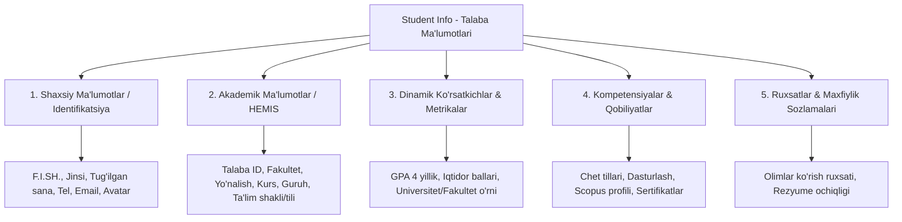

# TIU Talents — Talaba Ma'lumotlari (Student Info) Mantiqiy Modeli, Algoritmlari va Input Kategoriya Arxitekturasi

**Loyiha:** TIU Talents Platformasi  
**Mavzu:** Talaba Ma'lumotlari (Student Info) To'liq Mantiqiy Arxitekturasi va Chat Input Ichidagi Kategoriya Mexanizmi  
**Rol:** Lead System Architect & UI/UX Expert  

---

## 1. Chat Maydonida Kategoriya Tanlash Mexanizmi (Input Ichida)

Foydalanuvchi talabiga ko'ra, kategoriya tanlash boshqa alohida satrlarsiz, **bevosita xabar yozish maydoni (input container) ichida faqat bitta tepaga qaragan strelka iconi (🔼 / ⬆️ / Chevron-Up)** ko'rinishida joylashadi.

```
┌──────────────────────────────────────────────────────────────────────────────────┐
│  📎   [🔼] [🏷️ GRANT ✕]  Xabar matnini yozing...                       😊   [ ✈ ] │
└──────────────────────────────────────────────────────────────────────────────────┘
```

### 1.1 UI/UX Mantiqi:
1. **Dastlabki holat:**
   * Input ichida chapdan o'ngga: `📎 (Qistirgich)` ➡️ `🔼 (Tepaga qaragan strelka iconi)` ➡️ `Xabar matni inputi` ➡️ `😊 (Emoji)` ➡️ `✈ (Jo'natish)`.
   * Strelka ustiga borganda (hover) tooltip: *"Xabar toifasini tanlash (Grant, Konferensiya, Yangilik...)"*.
2. **Bosilganda (Click Event):**
   * Tepaga qaragan strelka bosilganda, bevosita input ustida ixcham, suzuvchi (floating popover) toifalar oynasi ochiladi:
     * `🔹 GRANT` — Ilmiy va xalqaro grantlar loyihalari
     * `🟣 CONFERENCE` — Ilmiy konferensiyalar, anjuman tezislari
     * `🟢 RESEARCH` — Ilmiy maqolalar va tadqiqotlar
     * `🟡 STARTUP` — Biznes va innovatsion g'oyalar
     * `🔴 DEADLINE` — Muddatli hisobot va vazifalar
     * `🔵 NEWS` — E'lonlar va yangiliklar
3. **Tanlanganda:**
   * Tanlangan toifa input ichida nozik, ixcham tamg'a (chip) ko'rinishida paydo bo'ladi (masalan: `[🏷️ GRANT ✕]`).
   * Talaba `✕` tugmasini bosib toifani olib tashlashi yoki `🔼` tugmasini qayta bosib toifani almashtirishi mumkin.

---

## 2. Talaba Ma'lumotlari (Student Info) To'liq Arxitekturasi

Talaba ma'lumotlari tizimda 5 ta asosiy qatlamdan (Layers) tashkil topgan:



---

## 3. Talaba Ma'lumotlarining 5 Ta Asosiy Algoritmi

### 3.1 ALGORITM 1: Profil To'ldirilganlik Darajasi (Profile Completeness Meter)
Tizim talabaning o'z profilini qanchalik to'liq shakllantirganini vaznli foiz (0% - 100%) shkalasida hisoblaydi.

$$\text{Profile Score} = \sum_{i=1}^{n} w_i \times c_i$$

Bu yerda $w_i$ — har bir blokning vazni, $c_i \in \{0, 1\}$ — to'ldirilganlik holati:

| Maydon / Blok | Vazni ($w_i$) | Sharti ($c_i = 1$) |
| :--- | :---: | :--- |
| **Profil rasmi (Avatar)** | 10% | Haqiqiy fotosurat yuklangan |
| **Telefon va Telegram** | 10% | Telefon kiritilgan va Telegram bot ulangan |
| **Akademik guruh va yo'nalish** | 15% | Fakultet, yo'nalish, guruh, ta'lim shakli tanlangan |
| **Qisqacha ilmiy bio / Maqsad** | 10% | Kamida 50 ta belgidan iborat ilmiy maqsad yozilgan |
| **Kamida 1 ta tasdiqlangan yutuq** | 25% | Diplom, sertifikat yoki maqola dekanatdan o'tgan |
| **Til bilish sertifikati (IELTS/CEFR)**| 15% | Sertifikat kiritilgan va balli tasdiqlangan |
| **Scopus / ORCID / GitHub havolasi** | 15% | Kamida bitta rasmiy ilmiy identifikator biriktirilgan |
| **JAMI** | **100%** | **To'liq to'ldirilgan professional profil** |

*Algoritmik qoida:* Profil $80\%+$ bo'lgandagina talaba universitetning Rektorat Xalqaro Grantlariga ariza bera oladi.

---

### 3.2 ALGORITM 2: Maydonlar O'zgarmasligi va Xavfsizligi (Data Immutability Policy)
Talaba ma'lumotlari firibgarlik va soxtalashtirishdan himoyalangan bo'lishi shart. Maydonlar 3 ta toifaga bo'linadi:

1. **ReadOnly (Faqat O'qish Uchun):**
   * *Maydonlar:* Talaba ID raqami, Pasport/JSHSHIR, HEMIS ID, Fakultet, Yo'nalish, Rasmiy GPA.
   * *Mantiq:* Bu ma'lumotlar faqat HEMIS API orqali yoki dekanat administratori tomonidan o'zgartiriladi. Talaba ularni tahrirlay olmaydi.
2. **Moderated (Moderatsiyadan So'ng Kuchga Kiruvchi):**
   * *Maydonlar:* Yangi ilmiy maqola, fan olimpiadasi diplomi, til sertifikati (IELTS).
   * *Mantiq:* Talaba kiritadi, biroq tasdiqlanmaguncha reytingga ta'sir qilmaydi (`is_verified = false`).
3. **Editable (Erkin Tahrirlanuvchi):**
   * *Maydonlar:* Bio, qiziqishlar, soft-skills, GitHub/LinkedIn havolalari, profil rasmi.

---

### 3.3 ALGORITM 3: Persentil va Dinamik Guruhlash (Leaderboard Percentile Tier)
Talabaning universitetdagi o'rnini shunchaki "#14-o'rin" emas, balki nufuzli toifalar (Tier) bo'yicha guruhlash algoritmi:

$$P = \left( 1 - \frac{R - 1}{N} \right) \times 100\%$$

* $R$ — talabaning reytingdagi tartib raqami.
* $N$ — universitetdagi (yoki fakultetdagi) jami faol talabalar soni.

* **Toifalar Mantiqi:**
  * $P \ge 99\%$ ➡️ **Tier 1: "Top 1% — President/Rector Talents"** (Oltin badj, barcha xalqaro loyihalarga to'g'ridan-to'g'ri tavsiyanoma).
  * $95\% \le P < 99\%$ ➡️ **Tier 2: "Top 5% — High Honors"** (Kumush badj, universitet ichki grantlari birinchi navbatda).
  * $90\% \le P < 95\%$ ➡️ **Tier 3: "Top 10% — Dean's List"** (Bronza badj, ilmiy mentorlik guruhlari).
  * $P < 90\%$ ➡️ **"Active Talent"** (Rivojlanayotgan iqtidorlar).

---

### 3.4 ALGORITM 4: 1-Click Dinamik Rasmiy TIU CV Generatsiyasi
Talaba "Rasmiy TIU CV" tugmasini bosganda tizim quyidagi tartibda PDF rezyumeni yig'adi:
1. **Header:** TIU rasmiy logotipi, Talaba F.I.SH., Talaba ID, Fakultet, Guruh, Ta'lim shakli.
2. **Academic Merit:** Rasmiy GPA ko'rsatkichi (4.85) va Persentil darajasi ("Top 1% Honor Student").
3. **Verified Publications:** Faqat `status === 'APPROVED'` bo'lgan Scopus va OAK maqolalari (DOI havolalari bilan).
4. **Certificates & Awards:** Tasdiqlangan olimpiada diplomlari va xalqaro sertifikatlar (IELTS, SAT).
5. **Dynamic QR Code:** Tizim maxsus xavfsiz URL va SHA-256 hash yaratadi:
   $$\text{QR URL} = \text{https://talents.tiu.uz/verify/cv/}\{\text{student\_id}\}?h=\{\text{hash}\}$$
   Ish beruvchi ushbu QR kodni skaner qilganda, ushbu ma'lumotlar soxta emasligi, haqiqatan TIU universiteti tomonidan tasdiqlanganligi ko'rsatiladi.

---

### 3.5 ALGORITM 5: Maxfiylik va Aloqa Ruxsatlari (Privacy & Contact Matrix)
Talaba o'z ma'lumotlarining ochiqligini boshqarishi mumkin:
* **Olimlar va Professorlar:** Barcha tasdiqlangan ilmiy maqolalar, GPA va loyihalarni ko'ra oladi (muloqotga taklif qilish uchun).
* **Boshqa Talabalar:** Faqat ism-familiya, to'plangan ball va reytingdagi o'rinni ko'radi (shaxsiy telefon raqami va shaxsiy hujjatlar ko'rinmaydi).
* **Tashqi Mehmonlar / Sayt tashrifchilari:** Faqat talabaning roziligi bilan berilgan "Public Portfolio" ko'rinishida umumlashtirilgan yutuqlarni ko'ra oladi.
