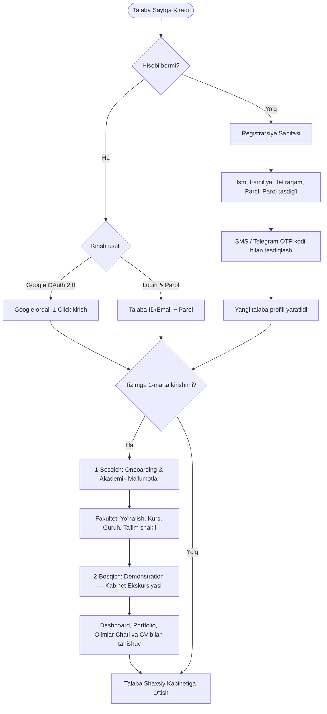

# TIU Talents — To'liq Mantiqiy Arxitektura, Bo'limlar va Tizim Algoritmlari

**Figma Dizayn Fayli:** [TIU Talents - Figma Design System](https://www.figma.com/design/UUkoZFQX04CXuMYlzaPcjw)  
**Muallif:** AI Lead Project Manager & UI/UX Expert  
**Rol:** Product Owner ko'rib chiqishi va tasdiqlashi uchun  

---

## 1. Autentifikatsiya va Onboarding Mantiqiy Sxemasi



---

## 2. Bo'limlar va Ularning Aniq Algoritmlari

### 2.1 ALGORITM 1: Registratsiya va Xavfsizlik Validatsiyasi
* **Kiruvchi ma'lumotlar:**
  * `first_name`, `last_name` (Kamida 2 ta harf, maxsus belgilar taqiqlanadi).
  * `phone_number` (+998 bilan boshlanuvchi 9 ta raqam: `^\+998[0-9]{9}$`).
  * `password` va `confirm_password`.
* **Xavfsizlik talablari (Password Policy):**
  * Kamida 8 ta belgi, kamida bitta katta harf, bitta raqam.
  * `password === confirm_password` qat'iy tekshiruvi.
* **Duplikat tekshiruvi:** Agar telefon raqam yoki email bazada mavjud bo'lsa, `"Ushbu raqam bilan avval ro'yxatdan o'tilgan. Tizimga kiring"` xabari chiqadi.

---

### 2.2 ALGORITM 2: Birinchi Kirish (Onboarding Wizard & Demonstration Tour)
Talaba ro'yxatdan o'tgach yoki Google orqali birinchi marta kirganda quyidagi avtomatik mantiq ishlaydi:
1. **Holat belgisi:** `is_first_login = true`.
2. **Akademik Anketa (Step 1):**
   * **Fakultet:** Universitet fakultetlari ro'yxatidan tanlanadi.
   * **Yo'nalish & Kurs:** Tanlangan fakultetga mos yo'nalishlar va 1-4 kurslar.
   * **Guruh:** Masalan `JUR-22-01`.
   * **Ta'lim shakli:** `Kunduzgi` (Daytime), `Sirtqi` (Part-time), `Masofaviy` (Distance).
   * **Ta'lim tili:** `O'zbek`, `Rus`, `Ingliz`.
3. **Kabinet Ekskursiyasi (Step 2 — Demonstration Tour):**
   * Tizim qoraytirilgan (backdrop-blur) fonga o'tadi va 4 ta asosiy blokka e'tiborni qaratadi:
     * **1-fokus: GPA & Iqtidor ballari** — "Bu yerda sizning umumiy reytingingiz aks etadi".
     * **2-fokus: Yutuq qo'shish tugmasi** — "Diplom, sertifikat va maqolalaringizni shu yerdan yuklaysiz".
     * **3-fokus: Olimlar Chati** — "3 ta jild (Yurisprudensiya, Biznes, TG-Bot) orqali nufuzli professorlar bilan bevosita grantlar ustida ishlaysiz".
     * **4-fokus: Rasmiy TIU CV** — "Barcha tasdiqlangan natijalaringizni nufuzli PDF rezyume sifatida yuklab olasiz".
   * Har bir fokusda `"Keyingisi"` yoki `"Tushunarli"` tugmasi orqali keyingi qadamga o'tiladi.
   * Tugagach: `is_first_login = false` qilib saqlanadi.

---

### 2.3 ALGORITM 3: Iqtidor Ballarini Hisoblash va Dinamik Reyting
Har bir talabaning umumiy ko'rsatkichi quyidagi vaznli formula orqali hisoblanadi:

$$\text{Total Score} = (\text{GPA} \times 40) + \sum \text{Verified Achievements Points}$$

* **Yutuqlar Ballari Shkalasi:**
  * **Scopus / Web of Science maqolasi:** $+100$ ball (Q1/Q2 jurnallari uchun $+150$ ball).
  * **OAK ro'yxatidagi ilmiy maqola:** $+50$ ball.
  * **Respublika Fan Olimpiadasi (1-3 o'rin):** $+150$ ball.
  * **Xalqaro Hakaton / Tanlov g'olibi:** $+120$ ball.
  * **Xalqaro Til Sertifikatlari:**
    * IELTS 7.0 / TOEFL 94: $+50$ ball
    * IELTS 7.5+: $+80$ ball
    * IELTS 8.0+: $+100$ ball
  * **Startap MVP / Grant yutug'i:** $+100$ ball.
* **Reytingni Qayta Hisoblash Triggeri:**
  * Dekanat har gal yangi yutuqni tasdiqlaganda (`status = 'APPROVED'`), tizim talabaning ballini yangilaydi va fakultet hamda universitet peshqadamlar jadvalidagi (Leaderboard) o'rnini darhol real vaqtda qayta tartiblaydi.

---

### 2.4 ALGORITM 4: Dekanat Moderatsiyasi va Verifikatsiya Oqimi
```
[Talaba Hujjat Yuklaydi] 
         │
         ▼
[Status: PENDING] ───> [Dekanat Tekshiruv Navbatiga tushadi]
                             │
            ┌────────────────┴────────────────┐
            ▼                                 ▼
   [Hujjat Mos va To'g'ri]         [Hujjat Noto'g'ri / Soxta / Xato]
            │                                 │
    [Status: APPROVED]               [Status: REJECTED]
    Talabaga ball qo'shiladi         Izoh qoldiriladi (masalan: "Skan xira")
    Push-xabarnoma boradi            Talabaga tuzatish xabari boradi
```

---

### 2.5 ALGORITM 5: "Olimlar Chati" (TIU Messenger) Sinxronizatsiyasi
* **3 ta Jild Taqsimoti:**
  * `Jild 1: Yurisprudensiya` — Huquq kafedralari ilmiy xodimlari.
  * `Jild 2: Biznes & Inovatsion` — Iqtisodiyot, startap va IT mentorlari.
  * `Jild 3: TG-Bot` — Telegram Bot orqali avtomatlashtirilgan xabarnomalar va tashqi Telegram foydalanuvchilari xabarlari.
* **Xabar Jo'natish va Marshrutlash:**
  * Foydalanuvchi xabar yozganda majburiy/ixtiyoriy ravishda `Kategoriya` tanlaydi (`NEWS`, `GRANT`, `CONFERENCE`, `DEADLINE`, `STARTUP`, `RESEARCH`).
  * Xabar darhol veb-interfeysda aks etadi va bir vaqtning o'zida Telegram Bot Webhook orqali tegishli olimning Telegram akkauntiga jo'natiladi.
  * Olim o'z Telegramidan javob yozganda, webhook uni qabul qilib, veb-chatdagi talabaga real vaqtda (WebSocket orqali) ko'rsatadi.
