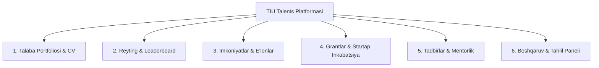
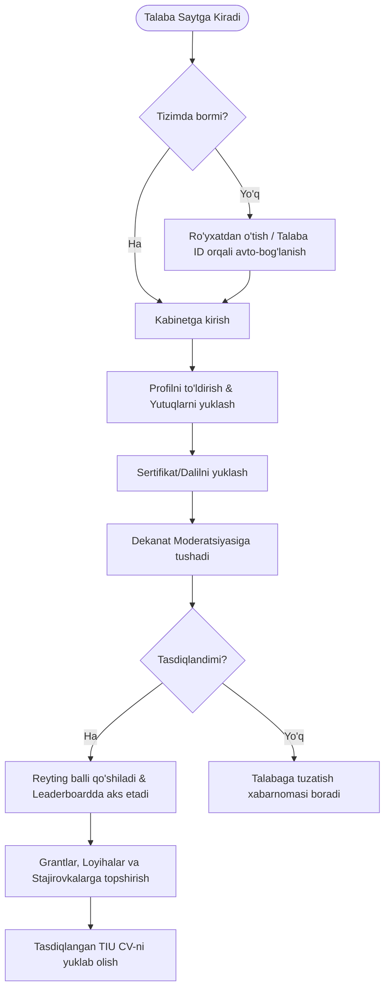

# TIU Talents — Mahsulot Talablari Hujjati (PRD) va UI/UX Arxitekturasi

**Loyiha:** TIU Talents — Toshkent Xalqaro Universiteti (TIU) Iqtidorli Talabalar va Imkoniyatlar Platformasi  
**Rol:** Product Owner: Foydalanuvchi | PM & Lead UI/UX: AI Assistant  
**Platforma:** Zamonaviy Responsive Web (Desktop, Tablet, Mobile)  
**Holat:** Rejalashtirish va Arxitektura Bosqichi  

---

## 1. Mahsulot Konsepsiyasi va Maqsadi

### 1.1 Muammo (Problem Statement)
* Universitetda tahsil olayotgan iqtidorli talabalar (fan olimpiadalari g'oliblari, startapchilar, dasturchilar, tadqiqotchi talabalar) to'g'risidagi ma'lumotlar tarqoq holda (qog'oz, alohida jadvallar, dekanatlar papkalarida) saqlanadi.
* Rektorat va dekanatlar istalgan vaqtda universitetning eng kuchli 1%, 5% talabalarini tezda aniqlash, ularni nufuzli grantlar, xalqaro dasturlar yoki ichki ilmiy/amaliy loyihalarga jalb qilishda qiynaladi.
* Talabalarda o'z yutuqlarini professional tarzda jamlovchi, tasdiqlangan (verifikatsiyalangan) raqamli portfolio va universitet ichidagi imkoniyatlardan (grantlar, startap inkubatsiyasi, mentorlik) xabardor bo'lish uchun yagona markaz yo'q.

### 1.2 Yechim (Solution)
**TIU Talents** — Universitet ichki ekotizimidagi barcha iqtidorlarni bir platformada jamlovchi, ularning yutuqlarini shaffof ball/reyting tizimi asosida baholovchi, universitet tomonidan e'lon qilinadigan loyihalar, grantlar va mentorlik imkoniyatlarini taqdim etuvchi markazlashgan boshqaruv va rivojlanish platformasi.

---

## 2. Foydalanuvchi Rollari (User Roles & Permissions)

| Rol | Maqsadi va Asosiy Imkoniyatlari |
| :--- | :--- |
| **Talaba (Student / Talent)** | Shaxsiy profil va akademik/amaliy portfoliosini shakllantirish, yutuqlar/sertifikatlarni yuklash, tasdiqlangan CV yuklab olish, reytingda o'z o'rnini ko'rish, grantlar, tanlovlar va tadbirlarga ariza topshirish, mentorlarga ulanish. |
| **Universitet Mas'uli (Admin / Dekanat / Iqtidorlar bo'limi)** | Talabalar kiritgan yutuqlarni tekshirish va tasdiqlash (moderatsiya), ballarni hisoblash mezonlarini boshqarish, yangi tanlovlar, grantlar va stajirovkalar e'lon qilish, arizalarni baholash. |
| **Rektorat & Rahbariyat (Super View / Analytics)** | Umumiy tahliliy dashboard (universitet, fakultet, yo'nalishlar bo'yicha KPI ko'rsatkichlari), Top-talabalar ro'yxatini ko'rish, hisobotlarni (PDF/Excel) bir tugma bilan eksport qilish. |
| **Mentor / Ilmiy rahbar** | Iqtidorli talabalar bilan ishlash, ilmiy maqola va startap loyihalarga kuratorlik qilish, maslahat sessiyalarini belgilash. |

---

## 3. Asosiy Modullar va Funksional Talablar

### 3.1 Modul 1: Talaba Portfoliosi & Dinamik CV Generator
* **Shaxsiy Ma'lumotlar:** Talaba ID, F.I.SH., Fakultet, Yo'nalish, Kurs, Guruh, GPA ko'rsatkichi.
* **Yutuqlar Bloki (Kategoriyalar):**
  * *Akademik & Ilmiy:* Nashr etilgan maqolalar (Scopus, OAK, xalqaro), olimpiada va tanlovlar sovrinlari.
  * *Kasbiy & IT/Biznes:* Startap loyihalar, ishlab chiqilgan dasturlar/saytlar, xalqaro sertifikatlar (IELTS, SAT, AWS, Google, Coursera va h.k.).
  * *Ijtimoiy faollik:* Universitet klublari yetakchiligi, volontyorlik faoliyati.
* **Hujjatli Dalil (Proof Submission):** Har bir yutuq uchun diplom, sertifikat yoki havola biriktiriladi (PDF/JPG formatda).
* **Bir martalik CV Export:** Kiritilgan va dekanat tomonidan tasdiqlangan ma'lumotlar asosida chiroyli TIU brendli PDF-rezyume (CV) shakllantiriladi.

### 3.2 Modul 2: Top Talents Leaderboard (Reyting Tizimi)
* **Shaffof Ball Mexanizmi:** Yutuq darajasiga qarab ball berish (masalan: Xalqaro olimpiada — 100 ball, Scopus maqolasi — 80 ball, IELTS 7.5+ — 50 ball va h.k.).
* **Ko'p darajali Filtrlar:**
  * Umumiy universitet reytingi (Top 10 / Top 50 / Top 100)
  * Fakultetlar va yo'nalishlar bo'yicha
  * Kurslar bo'yicha (1-kursdan bitiruvchilargacha)
  * Sohalar bo'yicha (IT, Iqtisodiyot, Pedagogika, Xorijiy tillar, Tibbiyot).
* **Talaba Gamifikatsiyasi:** Badjlar (Badges): "Olimpiadachi", "Innovator", "Ijtimoiy faol", "Tadqiqotchi".

### 3.3 Modul 3: Universitet Imkoniyatlari va Amaliyotlar Doskasi
* Universitet ichidagi laboratoriyalar, kafedralar va xalqaro bo'limda mavjud bo'lgan bo'sh o'rinlar (Assistentlik, laborantlik, raqamli markaz stajirovkasi).
* Saralash filtri: faqat talabalar uchun mos, egiluvchan ish grafigiga ega lavozimlar.
* "1-Click Apply": Talaba o'z portfolio ma'lumotlari bilan bitta bosish orqali arizani yuborishi.

### 3.4 Modul 4: Grantlar, Startaplar va Ilmiy Loyihalar Qabuli
* Universitet ichki grantlari va rektor mukofotlari uchun e'lonlar.
* Arizalarni qabul qilish shakli: G'oya/loyiha taqdimoti (pitch deck), jamoa a'zolari, zarur byudjet va kutilayotgan natijalar.
* Mas'ul hay'at (hakamlar) uchun shaxsiy kabinet: arizalarni ko'rib chiqish, 100 ballik shkalada baholash va xulosa berish.

### 3.5 Modul 5: Tadbirlar va Mentorlik Markazi
* Universitetdagi hakatolar, ilmiy anjumanlar, master-klasslar kalendari.
* Ro'yxatdan o'tish va QR-kod orqali qatnashishni tasdiqlash.
* Mentorlik: Tajribali professor-o'qituvchilar va amaliyotchi mutaxassislarning profillari, ularga 1-on-1 konsultatsiyaga yozilish mexanizmi.

### 3.6 Modul 6: Boshqaruv va Tahlil Paneli (Admin & Rektorat)
* **Verifikatsiya oqimi (Moderation Queue):** Talabalar yuklagan diplom va yutuqlarni bir bosishda "Tasdiqlash" yoki "Qaytarish (sababi bilan)".
* **Universitet iqtidorlar xaritasi:** Qaysi fakultet eng faol, qaysi yo'nalishda startaplar ko'p, umumiy GPA o'sish dinamikasi.
* **Eksport va Hisobotlar:** Vazirlik yoki universitet ilmiy kengashi uchun bir lahzada rasmiy ro'yxatlarni generatsiya qilish.

---

## 4. Foydalanuvchi Yo'li (User Flow)

---

## 5. UI/UX Dizayn Tizimi (Design System Guidelines)

### 5.1 Dizayn Falsafasi
* **Professional & Akademik:** Universitet nufuzini ko'rsatuvchi, ishonchli, toza va chalg'itmaydigan vizual muhit.
* **Intuitiv Boshqaruv:** Talaba murakkab qo'llanmalarsiz 2 daqiqa ichida o'z portfolioga yangi yutuq qo'sha olishi kerak.
* **Data-Dense yet Clear:** Ko'p statistik ma'lumotlar, reytinglar va jadvallar qulay kartalar va zamonaviy infografika ko'rinishida taqdim etiladi.

### 5.2 Ranglar Palitrasi (Color Palette)
* **Primary (Asosiy brend rangi):** `#1A365D` (Deep Academic Navy — nufuz, ishonch, bilim)
* **Secondary / Accent (Urg'u rangi):** `#C59B27` yoki `#D97706` (Royal Gold / Amber — iqtidor, yutuq, muvaffaqiyat)
* **Success / Verified:** `#10B981` (Smaragd yashil — tasdiqlangan sertifikatlar uchun)
* **Background & Surface:** `#F8FAFC` (Slate light), sof oq `#FFFFFF` kartalar bilan
* **Text & Typography:** Sarlavhalar uchun `#0F172A` (Slate 900), matnlar uchun `#475569` (Slate 600).

### 5.3 Tipografika
* Sarlavhalar va Interfeys: **Inter** yoki **Plus Jakarta Sans** (zamonaviy, yuqori darajada o'qiluvchan sans-serif).
* O'lchamlar ierarxiyasi: H1: 32px / H2: 24px / H3: 18px / Body: 14-16px / Small: 12px.

### 5.4 Asosiy Ekranlar (Wireframe Ruxsati)
1. **Bosh Sahifa (Public Landing):** Universitet iqtidori raqamlarda, Top-talabalar ko'rgazmasi, eng so'nggi grant/tanlovlar, tizimga kirish tugmasi.
2. **Talaba Dashboardi:** Profil to'liqligi (Progress bar), umumiy ball, faol arizalar holati, tezkor yutuq qo'shish moduli.
3. **Leaderboard (Reyting):** Podiyum (Top 3 talaba), kengaytirilgan filtrli jadval, har bir talabaning mini-kartasi.
4. **Imkoniyatlar Katalogi (Opportunities):** Filter panelli (Grantlar, Stajirovkalar, Hakatonlar) card-layout.
5. **Admin / Dekanat Tekshiruv Markazi:** "Moderatsiya navbati" — sertifikat skanini solishtirish va 1 bosish bilan ball tasdiqlash paneli.

---

## 6. Ishlab Chiqish Bosqichlari (Sprint Roadmap)

| Sprint | Muddat | Asosiy Vazifalar | Natija |
| :--- | :--- | :--- | :--- |
| **Sprint 1: Arxitektura & UI Dizayn** | 1-hafta | Wireframe'lar, Figma dizayn-tizimi, ma'lumotlar bazasi sxemasi (ERD) va barcha asosiy ekranlar prototipi. | Figma to'liq dizayni va tasdiqlangan UI kit. |
| **Sprint 2: Autentifikatsiya & Profil** | 2-hafta | Talaba va Admin rollari, Portfolio to'ldirish, fayllarni yuklash, Moderatsiya kabineti. | Ishlaydigan profil va tekshiruv mexanizmi. |
| **Sprint 3: Reyting & Imkoniyatlar** | 3-hafta | Ball hisoblash algoritmi, Leaderboard, Grantlar va stajirovkalar e'lon qilish paneli, arizalar qabuli. | Reyting va ariza topshirish oqimi tayyor. |
| **Sprint 4: CV Generator & Tahlil** | 4-hafta | PDF CV eksporti, Rektorat tahliliy dashboardi, test sinovlari va yakuniy ishga tushirish. | MVP to'liq tayyor. |
