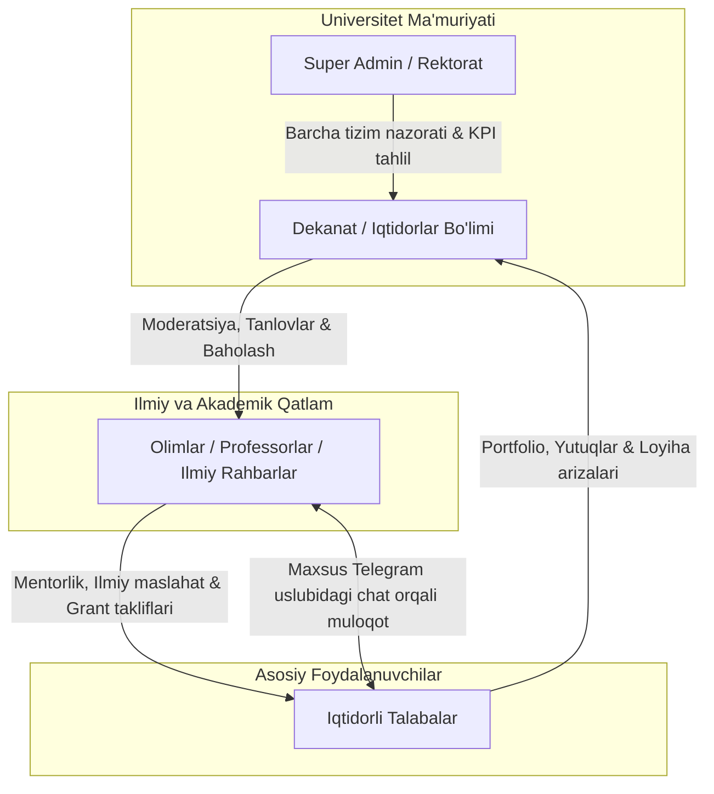
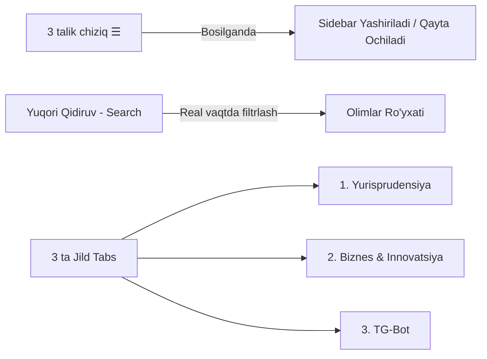

# TIU Talents — Mukammal Tizim Spetsifikatsiyasi, Rollar Arxitekturasi va "Olimlar Chati" UI/UX Standarti

**Loyiha:** TIU Talents (Toshkent Xalqaro Universiteti)  
**Hujjat turi:** To'liq Funksional Arxitektura, Rollar va Ruxsatlar Matritsasi (RBAC), "Olimlar Chati" UI/UX Spetsifikatsiyasi  
**Holat:** Mahsulot Rahbari (PO) Tasdig'i uchun  

---

## 1. Foydalanuvchi Rollari va Ularning To'liq Funksional Matritsasi (RBAC)

TIU Talents platformasida 4 ta asosiy foydalanuvchi roli mavjud. Har bir rol tizimda o'ziga xos maqsad, ruxsatlar va funksiyalar to'plamiga ega.



### 1.1 ROL 1: Iqtidorli Talaba (Talent / Student)
* **Maqsadi:** O'z salohiyatini namoyon etish, universitet olimlari bilan to'g'ridan-to'g'ri aloqa o'rnatish, grantlar va ilmiy loyihalarga jalb qilinish.
* **Asosiy Funksiyalari:**
  1. **Raqamli Portfolio:** Shaxsiy ma'lumotlar, GPA ko'rsatkichi, ilmiy maqolalar (DOI/havola bilan), startap loyihalar, olimpiada/tanlov diplomlari, xalqaro sertifikatlar (IELTS, SAT, dasturlash va h.k.) yuklash.
  2. **Olimlar Chati (TIU Messenger):**
     * 3 ta jild bo'yicha olimlarni saralash (Yurisprudensiya, Biznes va Innovatsiya, TG-Bot).
     * Olimning F.I.SH., unvoni, ixtisosligi va qabul holatini (Online / Band) ko'rish.
     * Olimga to'g'ridan-to'g'ri ilmiy maslahat, grant taklifi yoki konferensiya loyihasi bo'yicha xabar yozish.
     * Fayllar, taqdimotlar, ilmiy maqola qoralamalari va rasm/hujjatlarni biriktirish.
     * Xabarga maxsus kategoriya tamg'asini (`NEWS`, `GRANT`, `CONFERENCE`, `DEADLINE`, `RESEARCH`) biriktirib jo'natish.
  3. **Reyting & Leaderboard:** Fakultet va universitet bo'yicha o'z o'rni va to'plagan ballarini jonli kuzatish.
  4. **Bir martalik Rasmiy TIU CV Eksporti:** Dekanat tomonidan tasdiqlangan ma'lumotlar asosida avtomatik PDF rezyume olish.
  5. **Grantlar & Tanlovlarga Ariza:** Pitch-deck, ilmiy reja taqdim etish va ariza statusini ("Ko'rib chiqilmoqda", "Qabul qilindi", "Intervyu") kuzatish.

---

### 1.2 ROL 2: Universitet Olimi / Professor / Ilmiy Rahbar (Scientist / Mentor)
* **Maqsadi:** Iqtidorli talabalarni o'z ilmiy loyihalariga saralab olish, ularga mentorlik qilish, davlat va xalqaro grantlar ustida birgalikda ishlash.
* **Asosiy Funksiyalari:**
  1. **Olimning Shaxsiy Kabineti:** Ilmiy unvoni (PhD, DSc, Dotsent, Professor), kafedrasi, Scopus/h-indeksi, o'zining joriy ilmiy loyihalari ro'yxati.
  2. **Interaktiv Chat Muloqoti:**
     * Talabalardan kelgan so'rovlarni kategoriyalar (`GRANT`, `RESEARCH`, `DEADLINE`) bo'yicha saralab qabul qilish.
     * Talabalarga fayllar, metodik qo'llanmalar, so'rovnomalar (Polls) yuborish.
     * Guruhli ilmiy muhokamalar tashkil qilish.
  3. **TG-Bot Sinxronizatsiyasi:** Veb-platformaga kirmasdan ham, Telegram boti orqali talabaning xabarlarini qabul qilish va bot orqali javob qaytarish (xabarlar real vaqtda veb-saytga tushadi).
  4. **Talabani Ilmiy Loyihaga Biriktirish:** Munosib talabani 1 tugma orqali "Mening ilmiy jamoam" ro'yxatiga qo'shish va unga universitet ballini taqdim etish tavsiyanomasini berish.

---

### 1.3 ROL 3: Dekanat / Iqtidorlar Bo'limi Mas'uli (Admin / Moderator)
* **Maqsadi:** Tizimdagi ma'lumotlar haqqoniyligini ta'minlash, talabalar yutuqlarini tekshirish (verifikatsiya) va imkoniyatlar bazasini yangilab borish.
* **Asosiy Funksiyalari:**
  1. **Verifikatsiya Navbati (Moderation Queue):** Talabalar yuklagan diplom, maqola va sertifikatlarni asliga solishtirib tekshirish, ball biriktirish yoki rad etish (sababini ko'rsatgan holda).
  2. **Olimlar va Jildlarni Boshqarish:** Olimlarni tegishli jildlarga (Yurisprudensiya, Biznes va Innovatsiya, IT/TG-Bot) taqsimlash, yangi ilmiy rahbarlarni ro'yxatdan o'tkazish.
  3. **Imkoniyatlar E'lon Qilish:** Yangi grantlar, ilmiy stipendiyalar, laboratoriya assistentligi bo'yicha e'lonlar joylashtirish.
  4. **So'rovnomalar va E'lonlar:** Universitet miqyosida talabalar va olimlar uchun so'rovnomalar yaratish.

---

### 1.4 ROL 4: Rektorat / Boshqaruv Rahbariyati (Super Admin / Executive View)
* **Maqsadi:** Universitet iqtidorlar kapitali bo'yicha strategik tahlil, KPI nazorati va rasmiy hisobotlarni shakllantirish.
* **Asosiy Funksiyalari:**
  1. **Global Analitik Dashboard:**
     * Universitetdagi jami iqtidorli talabalar soni (fakultetlar, kurslar, jins, yutuqlar kesimida).
     * Faol ilmiy grantlar va loyihalarga jalb etilgan talabalar foizi.
     * Qaysi kafedra va professorlar iqtidorlar bilan eng faol ishlayotgani monitoringi.
  2. **Rasmiy Hujjatlar Eksporti:** OAK, Vazirlik va Akkreditatsiya komissiyasi uchun iqtidorlar hisobotini bir zumda Excel/PDF formatida yuklab olish.
  3. **Audit va Xavfsizlik:** Barcha ma'lumotlar o'zgarishi, ballar berilishi va chat yozishmalarining xavfsiz loglarini kuzatish.

---

## 2. "Olimlar Chati" (TIU Telegram Messenger) UI/UX Arxitekturasi

Foydalanuvchi taqdim etgan dizayn talablari va vizual etalonlar asosida quyidagi qat'iy interfeys spetsifikatsiyasi shakllantirildi:

### 2.1 Vizual Stilistika va Chat Belgisi (Brand Identity)
* **Asosiy Chat Belgisi (Chat Icon):** Taqdim etilgan tasvir asosida — shaffof, havorang-ko'k gradiyentli, bir-birini qoplovchi ikkita speech bubble (glassmorphic 3D pufakchalar), oldingi pufakchada oq uch nuqta `...` bilan ifodalanadi.
* **Ranglar Gammasi:** 
  * Header va tugmalar: Telegram Cyan/Azure Blue (`#2AABEE` / `#229ED9`), chuqur TIU Navy (`#1E3A8A`).
  * Fon: Telegram Desktop uslubidagi yoqimli yumshoq neytral fon (`#EFE8DE` / `#F0F2F5`).
  * Kartalar va oynalar: Sof oq (`#FFFFFF`) va nozik soya effektlari (`box-shadow: 0 4px 20px rgba(0,0,0,0.08)`).

---

### 2.2 Chap Panel: Jildlar va Olimlar Ro'yxati (Sidebar)



1. **Gamburger Tugmasi (3 talik chiziq — ☰):**
   * Bosilganda butun chap sidebar silliq (smooth CSS transition) bilan chapga yig'iladi (collapse).
   * Natijada chat maydoni to'liq kenglikni egallaydi. Qayta bosilganda sidebar joyiga qaytadi.
2. **Qidiruv Maydoni (Search Bar):**
   * "🔍 Olimlarni qidirish..." inputi.
   * Olimning F.I.SH., ixtisosligi, ilmiy darajasi yoki kalit so'zlari bo'yicha bir zumda real vaqtda saralaydi.
3. **3 ta Maxsus Jild (Folder Tabs):**
   * **1-Jild: Yurisprudensiya:** Davlat va huquq nazariyasi, xalqaro huquq, fuqarolik huquqi bo'yicha fan doktorlari va dotsentlar.
   * **2-Jild: Biznes va Innovatsiya:** Raqamli iqtisodiyot, startaplar, menejment, moliya va innovatsion texnologiyalar olimlari.
   * **3-Jild: TG-Bot:** Telegram Bot orqali integratsiya qilingan tizimli avtomatlashtirilgan aloqa xizmati va tashqi murojaatlar oqimi.
4. **Olimlar Ro'yxati Elementi (Scientist List Item):**
   * Olimning professional fotosurati (Avatar) va onlayn statusi (yashil nuqta).
   * To'liq F.I.SH. (masalan: *Prof. Dr. Karimov Alisher Baxtiyorovich*).
   * Ilmiy unvoni va kafedrasi (masalan: *Xalqaro huquq kafedrasi mudiri, DSc*).
   * Oxirgi xabar vaqti va o'qilmagan xabarlar hisoblagichi (badge).

---

### 2.3 O'ng Panel: Chat Maydoni va Boshqaruv Paneli (Main Chat)

1. **Header (Yuqori qism):**
   * Tanlangan olimning avatari, to'liq F.I.SH., ilmiy yo'nalishi va faollik holati ("Onlayn", "Telegram orqali ulangan", "Faqat veb-sayt").
   * Oyna boshqaruv tugmalari (Kichraytirish `-`, Kengaytirish `⛶`, Yopish `✕`).
2. **Xabarlar Maydoni (Message History):**
   * Telegram Desktop uslubidagi pufakchalar: yuborilgan (talaba) xabarlar o'ng tomonda ko'k rangda, qabul qilingan (olim) xabarlar chap tomonda oq fonda.
   * Xabarlar tepasida biriktirilgan kategoriya belgisi (masalan: `[GRANT]` ko'k rangli badge).
   * Fayl ko'rinishi: PDF, Word yoki rasm ko'rinishida yuklab olish imkoniyati bilan.
   * So'rovnoma (Poll) vidjeti: savol va variantlar, ovoz berish natijasi.
3. **Kategoriya Tanlash (Tepaga Qaragan Strelka — 🔼 / Chevron-Up):**
   * Input ustida yoki yonida tepaga qaragan strelka iconi joylashgan.
   * Bosilganda qulay popover / floating chips chiqadi:
     * `NEWS` — Universitet yangiliklari va tadbirlari
     * `GRANT` — Ilmiy va xalqaro grantlar arizasi
     * `CONFERENCE` — Xalqaro va respublika ilmiy anjumanlari
     * `DEADLINE` — Muddatli topshiriqlar va hisobotlar
     * `STARTUP` — Innovatsion g'oyalar va startap loyihalar
   * Tanlangan kategoriya xabar maydonida darhol aks etadi.
4. **Qistirgich Menyusi (Paperclip / Attach 📎):**
   * Bosilganda Telegram kabi popup modal menyu ochiladi:
     * 📷 **Rasm va Video** (Media yuklash)
     * 📄 **Hujjat va Maqola** (PDF, DOCX, ZIP ilmiy fayllar)
     * 📊 **So'rovnoma (Poll)** (Variantli savol-javob shakllantirish)
     * 🔗 **Ilmiy Havola** (Scopus/ResearchGate/Web of Science havolasi)
5. **Matn Kiritish va O'ng Tomon Amallari:**
   * Katta, qulay ko'p qatorli input ("Xabar yozing...").
   * O'ng tomonda:
     * 😊 **Emoji Iconi:** Bosilganda qulay ilmiy va emotsional emojilar to'plami.
     * ✈️ **Jo'natish Tugmasi:** Telegram ko'k dumaloq aero-tugmasi (`Send`).

---

## 3. Ma'lumotlar Tuzilmasi va Aloqalar (Data Schema Outline)

```
[Users]
  - id, role (STUDENT, SCIENTIST, ADMIN, RECTORAT)
  - full_name, email, phone, avatar_url, tg_user_id
  - department, academic_degree, gpa_score, rating_points

[Folders]
  - id: 1 (Yurisprudensiya), 2 (Biznes & Innovatsiya), 3 (TG-Bot)
  - name, slug, description

[ScientistProfiles]
  - user_id -> Users.id
  - folder_id -> Folders.id
  - specialization, scopus_id, bio, office_room, is_online

[ChatMessages]
  - id, sender_id, recipient_id, folder_id
  - text, category (NEWS, GRANT, CONFERENCE, DEADLINE, etc.)
  - attachment_url, attachment_type (IMAGE, DOC, POLL)
  - poll_data (JSON: question, options, votes)
  - created_at, is_read, tg_sync_status
```
